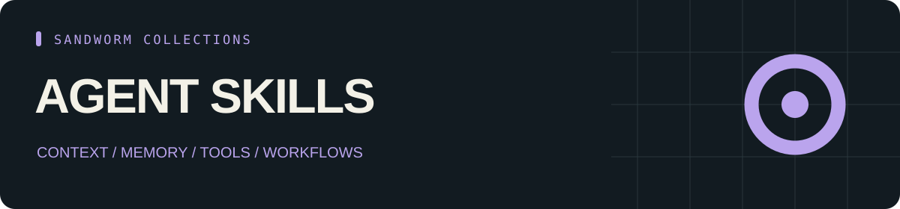

<p align="center"></p>

<p align="center"><b>13 skill entries · 18 tools · 26 source repositories</b></p>

# Sandworm Agent Skills

ชุดสกิลและเครื่องมือสำหรับออกแบบ Agent: context, memory, tools, orchestration, browser และช่องทางเสียง

[English](README.md) · [Skills](CATALOG.md) · [Tools](TOOLS.md) · [Start here](docs/start-here.md) · [Sources](SOURCES.md) · [หน้ารวมทุกคลัง](https://github.com/Sandworm-Lazarus/sandworm-arsenal)

คลังนี้มีสกิล 13 entries และเครื่องมือ 18 ตัว พร้อมลิงก์ที่ตรึง commit และคำอธิบายการใช้งาน อ่าน [เส้นทางเริ่มต้น](docs/start-here.md) เพื่อเลือกตามโจทย์

## เครื่องมือที่พัฒนาเอง: Tool Policy Gate

ตรวจสิทธิ์ principal/action/resource ตาม allowlist และเวลาหมดอายุ [Guide](docs/original-tool.md) · [Original work](ORIGINAL_WORK.md).

```bash
python3 scripts/tool_policy.py --policy examples/policy.json --request examples/request-allow.json --now 2030-01-01T00:00:00Z
python3 -m unittest discover -s tests -v
```

## ค้นหาและตรวจข้อมูล

ใช้ Python 3.9+ โดยไม่ต้องติดตั้ง dependencies เพิ่ม

```bash
python3 scripts/arsenal.py search "" --json
python3 scripts/arsenal.py tools "" --json
python3 scripts/arsenal.py stats
python3 scripts/arsenal.py check
```

## ระดับการตรวจ

Entry หมายถึงเคยอ่านไฟล์ entry ในงานรีเสิร์ชต้นทาง ส่วน Overview หมายถึงตรวจ frontmatter และเนื้อหาช่วงต้น เครื่องมือเป็นการตรวจภาพรวม README ไม่ได้รันทดสอบแพ็กเกจต้นทาง ดู [coverage](docs/review-status.md) ของคลังนี้ได้

งานคัดสรรและคู่มือของเราใช้ [MIT](LICENSE) ส่วนผลงานภายนอกใช้ license ของเจ้าของตาม [SOURCES.md](SOURCES.md) การอยู่ในคลังไม่ได้แปลว่าเป็นผลงานที่เราเขียนทั้งหมด

เครื่องมือบางตัวอยู่ได้มากกว่าหนึ่งคลังตามบริบทการใช้งาน จึงไม่ควรนำจำนวนจากทุก repo มาบวกเป็นจำนวนโครงการไม่ซ้ำ
